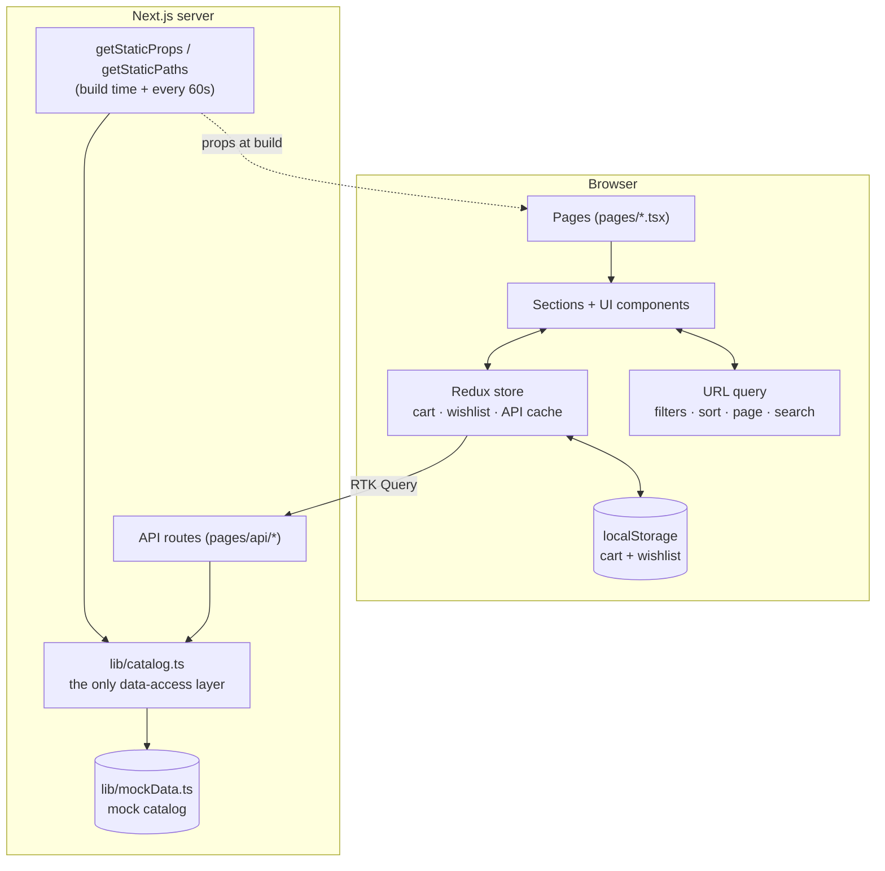

# Architecture

How the storefront is built and how its parts connect. Read `Rule.md` for
the rules that keep it this way.

## 1. High-level architecture



**The one idea to remember:** products reach the browser by two roads —
baked into pages at build time, or fetched from `/api/*` — and both roads go
through `lib/catalog.ts`. Replacing the mock catalog with a real backend
means changing that one file.

## 2. Tech stack

| Layer | Choice | Notes |
|---|---|---|
| Framework | Next.js 14, **Pages Router** | Not the App Router |
| Language | TypeScript, strict | `noUncheckedIndexedAccess` is on |
| Styling | Tailwind CSS 3 | Brand colors are CSS variables in `styles/globals.css` |
| State | Redux Toolkit | `cartSlice`, `wishlistSlice` |
| Data fetching (client) | RTK Query | One `apiSlice`; endpoints injected by `productsApi` |
| Animation | Framer Motion | Entrance animations, drawers |
| Icons | lucide-react | The only icon set |
| Font | Poppins 400 / 600 / 700 / 900 | Loaded with `next/font` in `pages/_app.tsx` |
| Images | `next/image` | Remote host allowed: `images.unsplash.com` |
| Tests | Vitest | Unit tests sit next to the file: `foo.test.ts` |
| Package manager | Yarn 1 | Node 18.17 or newer |

## 3. Folder structure

```
pages/                 One file per route
  index.tsx              Homepage
  category/[slug].tsx    Category listing
  product/[slug].tsx     Product page
  search.tsx  cart.tsx  wishlist.tsx  account.tsx  about.tsx  404.tsx
  checkout/index.tsx     Checkout form
  checkout/success.tsx   Order confirmation
  api/products/index.ts  GET /api/products?category=&q=
  api/products/[slug].ts GET /api/products/:slug
  api/categories.ts      GET /api/categories
  _app.tsx               Font, Redux Provider, Layout, persistence
  _document.tsx          <html> shell

components/
  layout/                Site-wide chrome: Navbar, Footer, CartDrawer, Seo, Layout
  sections/              Page-sized blocks: Hero, ShopByCategory, PromoBanner,
                         ProductGrid, ProductListing, FilterSidebar, ProductTabs,
                         NewsletterSignup, BrighterSideBanner
  ui/                    Small reusable pieces: Button, Badge, Rating, ProductCard,
                         CategoryCard, Breadcrumbs, Pagination, PriceRangeSlider,
                         WishlistButton, CartLineItem, EmptyState, BrandLogo, …

lib/                   Logic with no JSX
  catalog.ts             Server data access (the only reader of mockData)
  mockData.ts            Mock products and categories
  filters.ts             Parse / apply / serialize filters, pagination
  useUrlFilters.ts       Hook: filters ⇄ URL query
  checkout.ts            Form validation, order id
  images.ts              Every non-product photo
  storeConfig.ts         Currency, delivery threshold, return days, page size
  colors.ts              Color name → swatch hex
  i18n.ts                useTranslation(), formatTranslation(), formatCount()
  utils.ts               formatPrice(), discountPercent(), cn()

store/                 Redux
  store.ts  hooks.ts
  slices/cartSlice.ts  slices/wishlistSlice.ts
  api/apiSlice.ts  api/productsApi.ts
  persistence.ts         Save / restore cart + wishlist in localStorage

types/                 Shared TypeScript types (Product, CartItem, FilterState, LocaleStrings…)
locales/en.json        Every user-facing string
styles/globals.css     Tailwind layers, color variables, a few global classes
public/images/         Your own photos go here
docs/guidelines/       These documents
```

**Dependency direction** (a file may import from the layers below it, never
above):

```
pages  →  components/sections  →  components/ui  →  lib, store, types
                components/layout  ↗
```

## 4. How the parts connect

### Product data

| Step | What happens |
|---|---|
| 1 | `lib/mockData.ts` holds the products |
| 2 | `lib/catalog.ts` exposes `listProducts`, `getProduct`, `getFeaturedProducts`, `listProductSlugs` |
| 3a | Pages call the catalog in `getStaticProps` → products arrive as props (home, category, product) |
| 3b | API routes call the catalog → `productsApi` (RTK Query) fetches them in the browser (search, wishlist) |

Pages are static with `revalidate: 60`: built ahead of time and refreshed in
the background at most once a minute. Unknown category slugs return 404;
unknown product slugs return 404; new products render on first request.

### Filters, sorting and pages

All listing state lives in the **URL**, not in Redux:

```
/category/sunglasses?shape=round&color=Gold&price=30-45&sort=price-asc&page=2
```

`useUrlFilters()` reads the query into a `FilterState` and writes changes
back with a shallow route change. `ProductListing` then runs
`applyFilters()` and `paginate()` on the products it was given. Result: a
filtered view can be shared, bookmarked, and survives Back.

### Cart and wishlist

```
ProductCard / product page ──dispatch(addToCart)──▶ cartSlice ──▶ CartDrawer, Navbar badge, /cart, /checkout
                                                        │
                                             store/persistence.ts ⇄ localStorage
```

- `addToCart` also opens the cart drawer.
- A cart line is identified by **product id + color**.
- Saved data is restored *after* the page mounts (so server and browser
  markup match). Pages that depend on it wait for the `hydrated` flag before
  showing an "empty" message.
- The wishlist works the same way and stores product ids only.

### Text

Components never contain user-facing text. They call `useTranslation()` and
read from `locales/en.json`; its shape is enforced by `types/locales.ts`.
Server code uses `getTranslation()`.

### Images and store policies

- Product photos: the `images` array on each product in `lib/mockData.ts`.
- All other photos: `siteImages` in `lib/images.ts`.
- Delivery threshold, return days, currency, page size: `lib/storeConfig.ts`.

### SEO

Every page renders `<Seo>` (`components/layout/Seo.tsx`) for the title,
description, canonical URL and Open Graph tags. Product pages add
schema.org `Product` data. Cart, checkout, search, wishlist and account
pages are marked `noindex`.

## 5. Key user flows

**Browse → buy**

```
Home ─▶ Category (filter, sort, paginate) ─▶ Product ─▶ Add to Cart ─▶ Cart drawer ─▶ Checkout ─▶ Order confirmation
                                                   └──▶ Buy Now ───────────────────────┘
```

**Search:** Navbar search → `/search?q=…` → `/api/products?q=…` → same
`ProductListing` as category pages.

**Wishlist:** heart on any card or product page → `wishlistSlice` →
`/wishlist` loads the saved products through the API.

## 6. Development workflow

```
branch from main ─▶ change ─▶ yarn typecheck ─▶ yarn test ─▶ check in browser (desktop + 375px)
        ─▶ yarn build ─▶ update Task.md + Memory.md ─▶ commit ─▶ push ─▶ pull request ─▶ merge to main
```

| Command | Purpose |
|---|---|
| `yarn dev` | Development server at http://localhost:3000 |
| `yarn typecheck` | TypeScript check |
| `yarn test` | Unit tests |
| `yarn build` | Production build (stop `yarn dev` first — both use `.next/`) |

Branch names: `feat/…`, `fix/…`, `docs/…`. Details in `Rule.md`.

## 7. What changes when a real backend arrives

1. Rewrite the functions in `lib/catalog.ts` to call the backend (they may
   become `async`).
2. Keep the `Product` type as the contract, or map the backend's shape to it
   inside `catalog.ts`.
3. Delete `lib/mockData.ts`.
4. Replace the demo `handleSubmit` in `pages/checkout/index.tsx` with the
   payment provider and an order API route.

Pages, sections, filters, cart and wishlist should not need to change.
